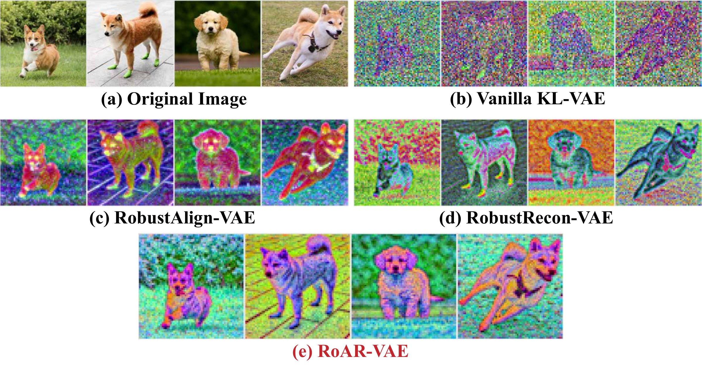
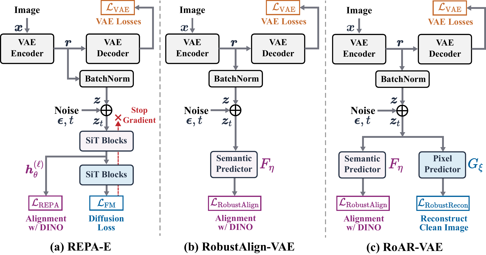
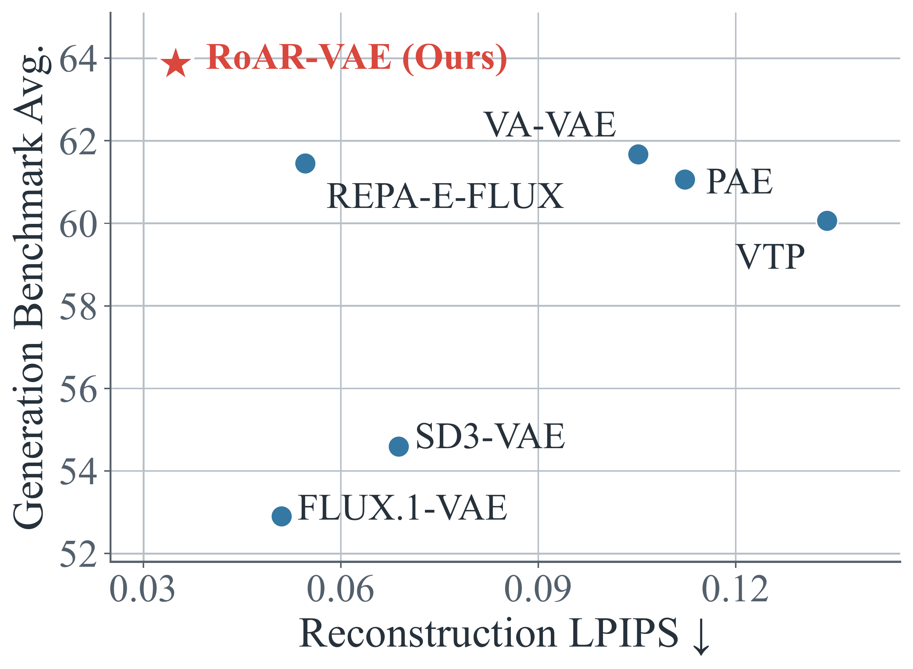
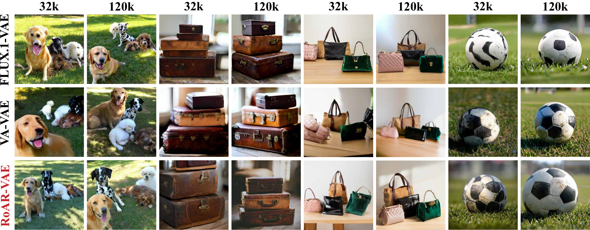
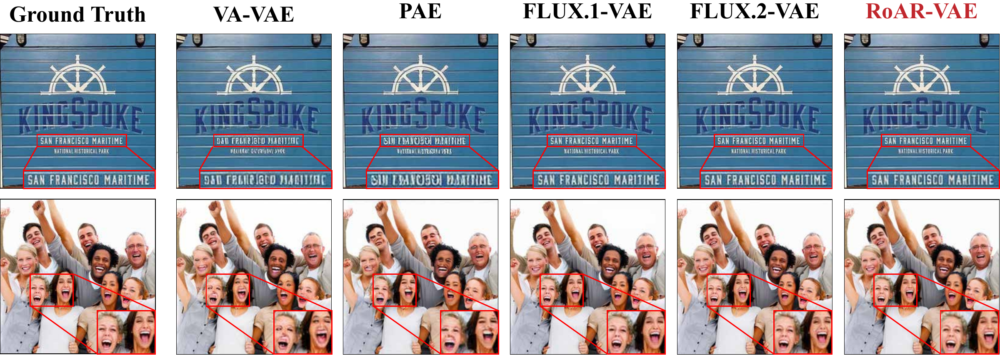

<div align="center">

# RoAR-VAE

**RoAR-VAE: Improving Latent Diffusability through Robust Prediction**

<p>
  Yang Yue<sup>1</sup> &emsp;
  Fangyun Wei<sup>2</sup> &emsp;
  Yitong Wang<sup>2</sup> &emsp;
  Jinjing Zhao<sup>2</sup><br>
  Henry Zheng<sup>1</sup> &emsp;
  Dong Chen<sup>2,✉</sup> &emsp;
  Gao Huang<sup>1,✉</sup>
</p>

<p>
  <sup>1</sup>Tsinghua University &emsp; <sup>2</sup>Microsoft Research<br>
  <sup>✉</sup>Corresponding authors
</p>


</div>

<p align="center">
  
</p>

*Top three principal components of normalized latent features, fitted jointly across the four images for each tokenizer.*

## Overview

**An open recipe for a VAE comparable to FLUX.2-VAE.** The key is **robust prediction**: recovering semantics and image details from noisy latents encourages useful information to become more prominent in dominant, high-variance latent directions. These directions retain more signal under noise and tend to be learned earlier by diffusion models, making the information more accessible during diffusion training.

## Method

**(a) REPA-E: where does the improvement come from?** REPA-E jointly trains a VAE and a diffusion model, but its diffusion loss does not directly update the VAE encoder. The extra encoder supervision comes from predicting semantic features from noisy latents.

**(b) RobustAlign: keep noisy semantic prediction.** Removing the diffusion objective and its dedicated blocks yields *RobustAlign*, which achieves downstream generation performance comparable to REPA-E under a matched evaluation. This motivates *robust prediction*: useful information should remain recoverable from noisy latents.

**(c) RoAR-VAE: recover fine details too.** Semantic features capture object structure but can miss textures and boundaries. We therefore also predict the clean image from noisy latents.

<p align="center">
  
</p>


## Reconstruction vs. Generation

<p align="center">
  
</p>


### Text-to-image Generation

<p align="center">
  
</p>


### Reconstruction

<p align="center">
  
</p>

## Code

**Coming soon.** Training code, inference code, and pretrained checkpoints will be released here.

## Citation

```bibtex
@misc{yue2026roarvae,
  title={RoAR-VAE: Improving Latent Diffusability through Robust Prediction},
  author={Yue, Yang and Wei, Fangyun and Wang, Yitong and Zhao, Jinjing and Zheng, Henry and Chen, Dong and Huang, Gao},
  year={2026}
}
```

## Contact

Yang Yue: [yueyang22@mails.tsinghua.edu.cn](mailto:yueyang22@mails.tsinghua.edu.cn)
